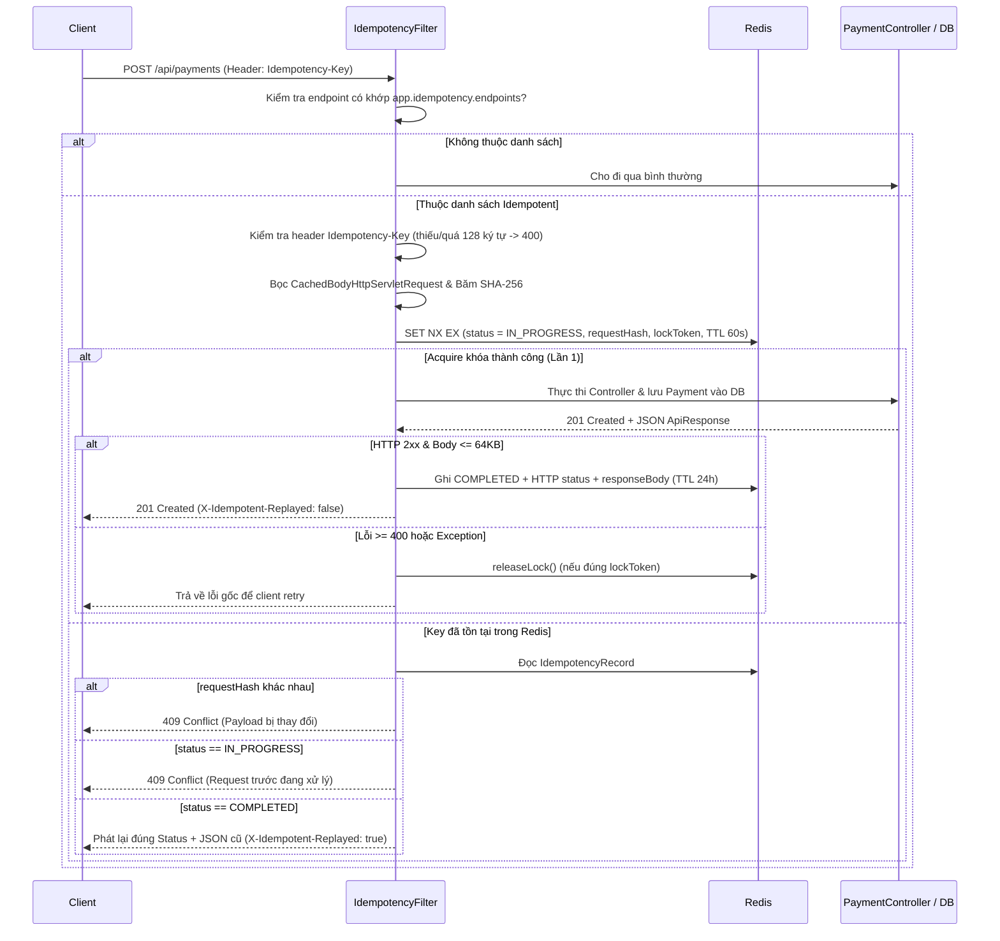

# Bài Học Thiết Kế & Triển Khai Redis Idempotency Filter Trong Java Spring Boot

> Tài liệu này giải thích **tư duy thiết kế**, **các bài toán thực tế** thúc đẩy kiến trúc, và **5 điểm cốt lõi kỹ thuật** đã được áp dụng để xây dựng bộ lọc Idempotency dùng Redis kết hợp với module `com.nlu.payment` trong `job-backend`.

---

## 1. Các bài toán thực tế khởi nguồn (Tại sao hệ thống Thanh toán bắt buộc phải có Idempotency?)

Trong giao thức HTTP, các phương thức như `GET`, `PUT`, `DELETE` về mặt lý thuyết được thiết kế để có tính **Idempotent** (gọi 1 lần hay $N$ lần thì trạng thái tài nguyên trên server vẫn như nhau), nhưng `POST` (tạo đơn hàng, tạo giao dịch thanh toán, trừ tiền) thì **không**.

Khi đưa hệ thống ra môi trường thực tế (production), bạn chắc chắn sẽ gặp 3 bài toán kinh điển sau:

### Bài toán 1: Double-Click / Rage-Click từ phía người dùng
Người dùng bấm nút **"Thanh toán"** trên trình duyệt hoặc app mobile khi mạng hơi lag, không thấy phản hồi ngay nên bấm liên tiếp 2–3 lần trong vòng 100ms.
- **Hậu quả nếu không có Idempotency:** 2–3 request song song đáp xuống các thread Tomcat khác nhau, cả 3 đều vượt qua bước kiểm tra ban đầu và ghi 3 dòng `Payment` xuống Database, dẫn đến trừ tiền khách hàng 3 lần.

### Bài toán 2: Network Timeout & Bài toán Hai vị tướng (Two Generals' Problem)
Đây là bài toán nổi tiếng trong hệ thống phân tán:
1. Client gửi `POST /api/payments` kèm `Idempotency-Key: pay-key-001`.
2. Backend nhận được, tạo giao dịch `PAY-8A3F...` và commit xuống PostgreSQL thành công.
3. Trên đường gói tin HTTP `201 Created` trả về cho Client, mạng bị đứt (wifi rớt, mobile mất sóng, hoặc load balancer timeout).
4. Client không biết giao dịch đã thành công hay chưa, nên tự động **retry** lại đúng request đó với cùng `Idempotency-Key`.

- **Hậu quả nếu chỉ chặn bằng lỗi `409 Conflict` cứng nhắc:** Client nhận lỗi ở lần retry dù tiền đã trừ và đơn đã tạo -> trải nghiệm người dùng tệ và dễ gây khiếu nại.
- **Giải pháp chuẩn công nghiệp (Stripe, PayPal, Adyen, IETF Draft `Idempotency-Key`):** Không tạo giao dịch thứ 2, mà **phát lại (Replay)** nguyên vẹn HTTP status code (`201 Created`) và JSON body của lần xử lý thành công đầu tiên.

### Bài toán 3: Cơ chế Retry tự động của Mobile SDK, API Gateway & Webhook
Các thư viện mạng (OkHttp, Retrofit, Axios retry interceptor), API Gateway hoặc hệ thống Webhook của đối tác thanh toán (VNPay, MoMo, Stripe) thường hoạt động theo cơ chế **At-Least-Once Delivery** (gửi ít nhất một lần). Khi kết nối chập chờn, hạ tầng sẽ tự động gửi lại request y hệt. Hệ thống Backend bắt buộc phải biến thao tác `POST` vốn *không idempotent* thành *idempotent* thông qua khóa định danh từ client.

---

## 2. Tư duy thiết kế: Làm thế nào để xây dựng giải pháp này từ đầu?

Thay vì viết code kiểm tra trùng lặp rải rác ở từng Service, quá trình thiết kế được chia làm 2 quyết định kiến trúc quan trọng:

### Bước 1: Chọn tầng can thiệp — `OncePerRequestFilter` thay vì Service hay AOP
Có 3 nơi có thể đặt logic Idempotency: trong từng Service, dùng Spring AOP (`@Around`), hoặc dùng **Servlet Filter (`OncePerRequestFilter`)**. Chúng ta chọn **`IdempotencyFilter` (kế thừa `OncePerRequestFilter`)** vì:
1. **Quản lý tập trung qua danh sách API:** Yêu cầu bài toán là Backend nắm một danh sách các API được áp dụng Idempotency. Ở tầng Filter, chỉ cần cấu hình danh sách `"METHOD /ant/path/**"` trong [application.yml](file:///d:/web-project/job-backend/src/main/resources/application.yml) (`IdempotencyProperties`) là có thể bật/tắt Idempotency cho bất kỳ endpoint nào mà **không cần sửa code Controller hay Service**.
2. **Chặn từ cửa ngõ (Fail-Fast):** Request trùng lặp hoặc thiếu `Idempotency-Key` bị chặn ngay ngoài Filter, không tốn chi phí bind JSON, validate DTO, mở Database connection hay khởi tạo `@Transactional`.
3. **Nắm trọn vẹn HTTP Status & Raw JSON Response:** Để *Replay* chính xác response cũ (kể cả header, HTTP status `201`, cấu trúc `ApiResponse`), tầng HTTP Filter là nơi tự nhiên nhất để bắt và ghi lại luồng byte của HTTP response.

### Bước 2: Đặt vị trí Filter trong `SecurityFilterChain`
Trong [SecurityConfig.java](file:///d:/web-project/job-backend/src/main/java/com/nlu/identity/infrastructure/config/SecurityConfig.java), `IdempotencyFilter` được đăng ký ngay **sau `JwtFilter`**:

```java
.addFilterBefore(jwtAuthFilter, UsernamePasswordAuthenticationFilter.class)
.addFilterAfter(idempotencyFilter, JwtFilter.class)
```

**Tại sao thứ tự này cực kỳ quan trọng?**
- Nếu đặt `IdempotencyFilter` *trước* `JwtFilter`, `SecurityContextHolder` lúc đó chưa có thông tin người dùng.
- Nếu User A gửi `Idempotency-Key: abc-123` và User B vô tình (hoặc cố ý) cũng gửi `Idempotency-Key: abc-123`, hai người sẽ đụng độ khóa hoặc User B có thể nhận lại response chứa thông tin thanh toán của User A!
- Khi đặt *sau* `JwtFilter`, `IdempotencyFilter.resolvePrincipalScope(...)` lấy được `user.getId()` từ `SecurityContextHolder` để tạo khóa Redis theo phạm vi riêng từng người dùng:
  ```text
  idempotency:user:101:pay-key-001
  ```
  *(Nếu là API public chưa đăng nhập, nó mới fallback về `ip:{clientIp}`).*

---

## 3. Luồng xử lý tổng thể



---

## 4. Năm (5) Điểm Cốt Lõi Kỹ Thuật Trong Triển Khai

### Điểm cốt lõi 1: Cạm bẫy `ServletInputStream` chỉ đọc được 1 lần & `CachedBodyHttpServletRequest`
Trong Java Servlet (Tomcat), `request.getInputStream()` đọc trực tiếp từ socket/buffer mạng. **Nó là luồng đọc một lần (one-time stream)**:
- Nếu `IdempotencyFilter` đọc `InputStream` để tính hash body trước khi gọi `filterChain.doFilter()`, thì khi request đi vào `PaymentController`, Jackson (`@RequestBody CreatePaymentRequest`) đọc lại `InputStream` sẽ thấy **rỗng (`EOF`)** và ném lỗi `HttpMessageNotReadableException: Required request body is missing`.
- Lưu ý: Spring có sẵn `ContentCachingRequestWrapper` (đang dùng ở [RequestLoggingFilter.java](file:///d:/web-project/job-backend/src/main/java/com/nlu/shared/infrastructure/filter/RequestLoggingFilter.java)), nhưng wrapper này chỉ lưu lại byte *sau khi* Controller đã đọc stream, nên không dùng được cho Filter cần đọc body *trước khi* vào Controller.

**Cách giải quyết ở [CachedBodyHttpServletRequest.java](file:///d:/web-project/job-backend/src/main/java/com/nlu/shared/infrastructure/idempotency/CachedBodyHttpServletRequest.java):**
- Khi khởi tạo wrapper, đọc toàn bộ byte vào mảng `byte[] cachedBody`.
- Ghi đè `getInputStream()` và `getReader()` để mỗi lần có thành phần nào gọi, nó đều trả về một `ByteArrayInputStream(this.cachedBody)` mới tinh. Nhờ đó Filter có thể băm body thoải mái, rồi `PaymentController` vẫn parse JSON `@RequestBody` bình thường.

---

### Điểm cốt lõi 2: Chống Race Condition bằng lệnh nguyên tử `SET NX EX` (`tryAcquire`)
Một lỗi rất hay gặp khi tự viết Idempotency là viết theo kiểu **Check-Then-Act**:
```java
// CÁCH SAI - GÂY RACE CONDITION:
if (redis.get(key) == null) {      // Thread A và B cùng thấy null tại t=0ms!
    redis.set(key, "IN_PROGRESS"); // Cả A và B cùng đi vào tạo 2 Payment!
}
```
Khi người dùng double-click, 2 request đến gần như đồng thời đều thấy `redis.get(key) == null` và cùng vượt qua.

**Cách giải quyết ở [IdempotencyService.java](file:///d:/web-project/job-backend/src/main/java/com/nlu/shared/infrastructure/idempotency/IdempotencyService.java):**
Dùng `redisTemplate.opsForValue().setIfAbsent(redisKey, inProgress, ttl)` — tương ứng với lệnh nguyên tử **`SET key value NX EX 60`** trong Redis. Vì Redis xử lý các lệnh trên một luồng đơn (single-threaded event loop), nếu 100 thread Java gọi `setIfAbsent` cùng một micro-giây:
- **Chỉ duy nhất 1 thread** nhận về `true` (giành được quyền xử lý request).
- **99 thread còn lại** nhận về `false` ngay lập tức và rơi vào nhánh `handleExistingIdempotencyRecord(...)`.

---

### Điểm cốt lõi 3: Máy trạng thái 2 pha (`IN_PROGRESS` -> `COMPLETED`), `lockToken` và 2 mức TTL
Một khóa Idempotency không chỉ có trạng thái "đã tồn tại" mà phải có vòng đời rõ ràng trong [IdempotencyStatus.java](file:///d:/web-project/job-backend/src/main/java/com/nlu/shared/infrastructure/idempotency/IdempotencyStatus.java):

1. **`IN_PROGRESS` (TTL ngắn — mặc định 60 giây):**
   - Được đặt ngay khi request bắt đầu xử lý. Nếu có request trùng gửi tới trong lúc request đầu đang gọi DB/cổng thanh toán, request thứ 2 nhận `409 Conflict` (*"A request with this Idempotency-Key is currently in progress"*).
   - **Tại sao TTL ngắn (60s)?** Nếu server bị tắt đột ngột (OOM, mất điện) trước khi chạy tới khối `finally`, khóa tự hết hạn sau 60s thay vì khóa vĩnh viễn user đó.
2. **`COMPLETED` (TTL dài — mặc định 86,400 giây = 24 giờ):**
   - Chỉ được ghi khi Controller trả về `2xx` (và kích thước body $\le$ 64KB để bảo vệ RAM Redis).
   - Lưu kèm `httpStatus`, `contentType`, `responseBody` để phục vụ Replay trong suốt 24 giờ.
3. **Giải phóng khóa khi gặp lỗi (`releaseLock` kiểm tra `lockToken`):**
   - Nếu request đầu tiên bị lỗi validation (`400 Bad Request`), lỗi server (`500`), hoặc exception chưa hoàn tất giao dịch: `IdempotencyFilter` gọi `releaseLock(scope, key, lockToken)` để xóa khóa. Client sửa lỗi và gửi lại cùng `Idempotency-Key` vẫn được phép thực thi lại.
   - **Vai trò của `lockToken` (UUID):** Đảm bảo chỉ đúng tiến trình đã tạo ra khóa `IN_PROGRESS` đó mới được quyền xóa nó (tránh trường hợp Request 1 bị treo quá 60s, TTL hết hạn, Request 2 vào giữ khóa mới rồi Request 1 tỉnh dậy xóa nhầm khóa của Request 2).

---

### Điểm cốt lõi 4: Chữ ký số của Request (`requestHash` SHA-256) chống tái sử dụng sai payload
Giả sử Client gửi:
- Lần 1: `Idempotency-Key: k1`, body `{"amount": 100000, "currency": "VND"}` -> Thành công.
- Lần 2: Client lại tái sử dụng `Idempotency-Key: k1` nhưng sửa body thành `{"amount": 500000, "currency": "VND"}`.

Nếu Filter chỉ nhìn mỗi `Idempotency-Key: k1` rồi trả lại kết quả 100,000đ của lần 1, hệ thống sẽ gây hiểu nhầm nghiêm trọng (client tưởng đã thanh toán đơn 500,000đ).

**Cách giải quyết trong [IdempotencyFilter.java](file:///d:/web-project/job-backend/src/main/java/com/nlu/shared/infrastructure/idempotency/IdempotencyFilter.java):**
Hàm `computeRequestHash(...)` băm SHA-256 tổ hợp:
```text
SHA-256( HTTP_METHOD + "|" + REQUEST_URI + "|" + QUERY_STRING + "|" + RAW_REQUEST_BODY_BYTES )
```
Khi key đã tồn tại trong Redis, Filter so sánh `Objects.equals(existing.getRequestHash(), requestHash)`. Nếu khác nhau -> từ chối ngay với **`409 Conflict`** (*"Idempotency-Key has already been used with a different request payload"*).

---

### Điểm cốt lõi 5: Bắt và phát lại phản hồi (`ContentCachingResponseWrapper` & `X-Idempotent-Replayed`)
Ở lần chạy đầu tiên thành công:
- `IdempotencyFilter` bọc `HttpServletResponse` bằng `ContentCachingResponseWrapper` của Spring.
- Sau khi `PaymentController` thực thi xong, Filter lấy `cachingResponse.getContentAsByteArray()`, lưu vào Redis, gắn header `X-Idempotent-Replayed: false`, và cuối cùng gọi `cachingResponse.copyBodyToResponse()` trong `finally` để đẩy JSON về cho client.
- Ở lần gọi trùng tiếp theo: Filter **không gọi `filterChain.doFilter(...)`**, tức là `PaymentController`, `PaymentServiceImpl` và PostgreSQL hoàn toàn không bị chạm tới. Filter ghi thẳng `existing.getResponseBody()` và `existing.getHttpStatus()` ra response kèm header **`X-Idempotent-Replayed: true`**.

---

## 5. Cách kiểm chứng hiệu quả thực tế

Trong [IdempotencyFilterAndPaymentTest.java](file:///d:/web-project/job-backend/src/test/java/com/nlu/payment/IdempotencyFilterAndPaymentTest.java), hiệu quả của bộ lọc được chứng minh qua 5 kịch bản:
1. Gọi `POST /api/payments` thiếu `Idempotency-Key` -> `400 Bad Request`, `paymentRepository.save(...)` chạy **0 lần**.
2. Gọi `POST /api/payments` 2 lần liên tiếp cùng `Idempotency-Key` và cùng payload -> Cả 2 lần đều trả `201 Created` với cùng `id` và `transactionCode` (`PAY-...`), lần 1 `X-Idempotent-Replayed: false`, lần 2 `X-Idempotent-Replayed: true`, và `paymentRepository.save(...)` chỉ chạy **đúng 1 lần**.
3. Gọi lại cùng `Idempotency-Key` nhưng đổi `amount` -> `409 Conflict`, DB chỉ có 1 bản ghi.
4. Giả lập một request đang ở trạng thái `IN_PROGRESS` trong Redis -> request song song nhận `409 Conflict`.
5. Gọi `GET /api/payments/me` (không nằm trong `app.idempotency.endpoints`) -> `200 OK` bình thường không đòi hỏi header.

---

## 6. Đánh giá Trade-offs & Hướng nâng cấp lên chuẩn Enterprise (Defense-in-Depth)

Bộ lọc Redis Filter hiện tại rất mạnh ở tốc độ cao và khả năng tái sử dụng cho hàng loạt API chỉ bằng cấu hình YAML. Tuy nhiên, nếu hệ thống thanh toán vận hành ở quy mô production chịu tải cao hoặc có yêu cầu tài chính khắt khe, bạn cần nắm rõ giới hạn sau:

- **Vấn đề mất dữ liệu Redis (Redis Restart / Eviction):** Redis là in-memory store. Nếu Redis bị restart (không bật AOF persistence) hoặc đầy RAM và đẩy key ra trước 24h, request retry sau đó sẽ thấy khóa không còn trong Redis.
- **Giải pháp Phòng thủ 2 lớp (Defense-in-Depth):**
  - **Lớp 1 (Cổng ngoài — đã làm):** `IdempotencyFilter` + Redis xử lý 99.9% trường hợp double-click, retry tức thời và replay response JSON cực nhanh.
  - **Lớp 2 (Tầng DB — có thể bổ sung khi cần tuyệt đối an toàn):** Lưu thêm cột `idempotency_key` (đánh `UNIQUE(user_id, idempotency_key)`) trên bảng `payments` trong PostgreSQL (tương tự cách `ResumeUploadSession` trong dự án này đang kết hợp giữa `ResumeUploadLockService` ở Redis và unique constraint ở PostgreSQL). Khi Redis mất key, Database vẫn là chốt chặn cuối cùng không bao giờ cho phép chèn 2 giao dịch trùng lặp.

