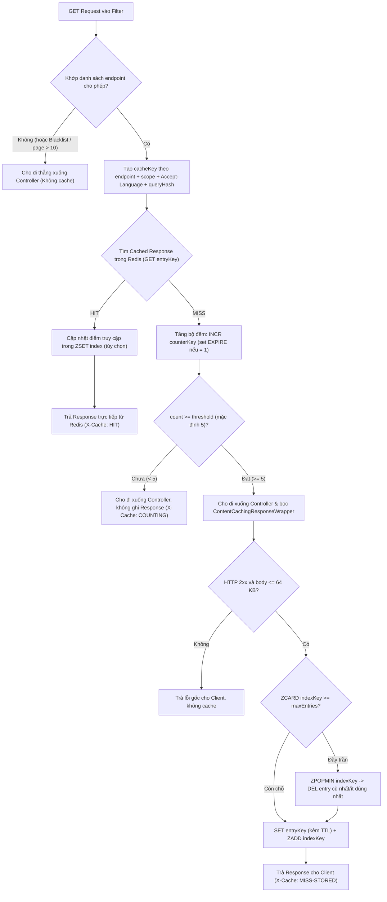

# Tính Toán Bộ Đếm Kích Hoạt, Giới Hạn Số Request, Dung Lượng Redis & Thời Gian Xóa Cache

> Tài liệu này trả lời chi tiết 4 câu hỏi về mặt định lượng và cơ chế lưu trữ Redis khi cache toàn bộ HTTP Response của các `GET` request:
> 1. **Số lần đếm (`Threshold`)** nào chứng minh request đủ "nóng" để đáng cache?
> 2. **Cơ chế giới hạn số lượng request** được phép nằm trong cache để không tràn RAM Redis?
> 3. **Redis phải gánh bao nhiêu RAM** khi lưu cả phần Response?
> 4. **Thời gian sống (`TTL`) và cơ chế xóa cache** như thế nào là an toàn nhất?

---

## 1. Tại Sao Không Cache Ngay Từ Lần Đầu Mà Phải Đếm (Hot-Request Promotion)?

Nếu request nào gọi 1 lần cũng lưu trọn cả JSON response (`2 KB – 20 KB`) vào Redis, các request "đuôi dài" (ví dụ người dùng gõ tìm kiếm linh tinh `/api/blogs?title=xyz123`, bot quét `/api/jobs/999999`, hoặc user chỉ vào xem 1 lần rồi thoát) sẽ chiếm sạch RAM Redis trong khi **tỷ lệ Cache Hit = 0%**.

Do đó, ta tách làm **2 tầng dữ liệu** trong Redis:

1. **Tầng 1 — Bộ đếm nhẹ (`Hot Counter Key`):**
   - Lưu bằng lệnh `INCR` + `EXPIRE` (giống [RateLimitServiceImpl.java](file:///d:/web-project/job-backend/src/main/java/com/nlu/identity/application/impl/RateLimitServiceImpl.java#L28-L41)).
   - Chỉ lưu một số nguyên (`1, 2, 3, 4...`), kích thước mỗi key chỉ **~100–120 bytes**.
   - Nếu trong cửa sổ thời gian (`windowSeconds`, ví dụ `60s` hoặc `300s`) mà key đó chỉ được gọi 1–4 lần, nó **không bao giờ chiếm chỗ lưu Response** và tự biến mất khi hết cửa sổ.
2. **Tầng 2 — Kho chứa Response (`Cached Response Key`):**
   - Chỉ được tạo khi bộ đếm đạt ngưỡng kích hoạt (`count >= threshold`, mặc định **`5`**).

### Cách chọn ngưỡng đếm chứng minh cần cache (`Threshold`)

| Mức độ nặng của API / Nhóm dữ liệu | Ngưỡng đề xuất (`Threshold`) | Cửa sổ đếm (`Window`) | Lý giải kỹ thuật |
| :--- | :---: | :---: | :--- |
| **API đọc bình thường (Public / Admin / User list)** | **5 lần** | **60s** (hoặc **300s** cho trang chi tiết `/jobs/{id}`, `/blogs/{id}`) | Với `window = 60s`, đạt 5 lần nghĩa là lưu lượng đạt $\ge 5\text{ req/phút}$ (đang có cụm truy cập thật hoặc nhiều người cùng mở trang). Với trang chi tiết Job/Blog, mở rộng cửa sổ lên `300s` (5 phút) giúp bắt được các tin tuyển dụng có ~1 lượt xem mỗi phút. |
| **Master data siêu ổn định** (`/api/v1/categories`) | **3 lần** | **300s** | Dữ liệu gần như bất biến và mọi người dùng đều cần tải dropdown danh mục. Chỉ cần 3 lượt trong 5 phút đã đủ chứng minh hệ thống đang có traffic thật. |
| **Truy vấn AI / Vector cực nặng** (`/api/user/jobs/match/{cvId}`) | **3 lần** | **120s** | Query `pgvector` cosine distance trên `jd_vectors <=> cv_vectors` tốn CPU PostgreSQL gấp nhiều lần query thường. Giảm ngưỡng xuống 3 lần giúp bảo vệ DB sớm hơn khi user bấm qua lại màn hình gợi ý việc làm. |

---

## 2. Luồng Đếm 5 Lần Và Chốt Chặn Giới Hạn Số Request (`Quota Eviction`)

### Làm thế nào giới hạn được số GET Request nằm trong Cache?

Mỗi endpoint cấu hình một hạn mức riêng **`maxEntries`** (đã liệt kê ở [01-bang-thong-so-get-api-cache.md](file:///d:/web-project/docs/cache/01-bang-thong-so-get-api-cache.md), ví dụ `/api/jobs/{id}` tối đa `500`, `/api/blogs` tối đa `50`, `/api/user/jobs/match/{cvId}` tối đa `300`).

Để ép chặt giới hạn này theo đúng **từng endpoint** (tránh trường hợp `/api/jobs/{id}` chiếm hết chỗ của `/api/blogs` hoặc ngược lại), ta dùng thêm một cấu trúc **`Redis ZSET`** làm bảng mục lục cho từng endpoint:

- **Tên ZSET:** `http_cache:index:{endpointId}` (ví dụ `http_cache:index:public_job_detail`).
- **Member:** `entryKey` (khóa của response đang được cache).
- **Score:** `lastAccessEpochMs` (chính sách **LRU** — xóa cái lâu không ai gọi nhất) hoặc `expireAtEpochMs` (**FIFO/Earliest-Expire** — đơn giản hơn vì không cần ghi lại Redis khi Cache HIT).
- **Cơ chế giữ trần (`Atomic Quota Check` bằng Lua Script):**
  1. Kiểm tra `ZCARD http_cache:index:{endpointId}`.
  2. Nếu số lượng hiện tại $\ge \text{maxEntries}$ (và `entryKey` chưa có trong ZSET): gọi `ZPOPMIN` lấy ra phần tử có score nhỏ nhất (cũ nhất / ít dùng nhất), gọi `DEL` xóa `entryKey` đó, rồi mới `SET` entry mới và `ZADD` vào ZSET.
  3. Ngoài ra, định kỳ hoặc khi `ZCARD` kiểm tra, lọc bỏ các member đã tự hết hạn `TTL` để ZSET không giữ "rác" tên key.

### Chốt chặn chống làm nổ số lượng Key từ Query String (Parameter Normalization)
Với các API có query param như `GET /api/jobs/newest?page=0&size=10` hoặc `GET /api/blogs?pageIndex=0&pageSize=10&title=...`:
- **Chuẩn hóa Query String:** Sắp xếp các tham số theo thứ tự bảng chữ cái, cắt khoảng trắng (`trim`), bỏ qua các tham số rác không có trong whitelist (ví dụ `utm_source`, `fbclid`, `_t=timestamp`) để tránh tạo hàng triệu cache key cho cùng 1 nội dung.
- **Chặn biên phân trang:** Chỉ đếm và cache khi `page <= 10` và `size <= 50` (trong thực tế 95% người dùng chỉ xem trang 0–3; bot cào trang 100–500 sẽ bị bỏ qua không cho vào cache).
- **Chặn kích thước Body:** Giống [IdempotencyConstants.java](file:///d:/web-project/job-backend/src/main/java/com/nlu/shared/infrastructure/idempotency/IdempotencyConstants.java#L10), đặt trần **`MAX_CACHEABLE_BODY_BYTES = 65_536` (64 KB)** cho 1 response. Nếu vượt quá 64 KB thì bỏ qua không lưu vào Redis.

---

## 3. Tính Toán Chi Tiết Dung Lượng RAM Redis

Vì lưu tại tầng Filter, mỗi `Cached Response Key` không chỉ chứa dữ liệu thô mà phải lưu một object bọc (tương tự `IdempotencyRecord`) gồm:
- `httpStatus` (`int`, ví dụ `200`)
- `contentType` (`String`, ví dụ `"application/json;charset=UTF-8"`)
- `encoding` (`String`: `"identity"` hoặc `"gzip"`)
- `responseBody` (`String` JSON hoặc `byte[]` Base64/raw)
- `createdAtEpochMs` (`long`)

### Công thức ước tính RAM thực tế trên Redis cho 1 entry

$$\text{RAM}_{1\text{ entry}} \approx \text{Key (~90 B)} + \text{Redis Overhead (~64 B)} + \text{Metadata JSON (~100 B)} + \text{Payload Size}$$

*(Tổng overhead cố định cho mỗi entry vào khoảng **~250 bytes**).*

### Bảng tổng hợp dung lượng RAM tối đa (Kịch bản Worst-Case đầy 100% Quota)

| Phân khu dữ liệu trong Redis | Số lượng Key tối đa | RAM (Lưu JSON thuần) | RAM (Nếu nén Gzip payload $> 2\text{ KB}$) | Ghi chú |
| :--- | :---: | :---: | :---: | :--- |
| **Nhóm A — Public GET** (11 APIs) | **1,326 keys** | `~9.58 MB` | **`~2.55 MB`** | Chiếm nhiều nhất là 500 tin `/api/jobs/{id}` (`~10 KB/tin`) và 200 bài `/api/blogs/{id}` (`~18 KB/bài`) |
| **Nhóm B — Admin GET** (16 APIs) | **212 keys** | `~0.55 MB` | **`~0.22 MB`** | Chủ yếu là số liệu metrics (`~250 B`) và danh sách phân trang (`~3 KB`) |
| **Nhóm C — User-scoped GET** (15 APIs) | **2,320 keys** | `~6.03 MB` | **`~2.15 MB`** | Chiếm nhiều nhất là `/api/hirer/jobs/posted` (`~12 KB`) và `/api/user/jobs/match/{cvId}` (`~5 KB`) |
| **Tầng Counter (`Hot Counter Keys`)** | **~10,000 keys** *(giả định đang đếm dở trong 1 phút)* | `~1.15 MB` | **`~1.15 MB`** | Mỗi counter key chỉ tốn `~115 B`, tự xóa sau `60s–300s` |
| **Tầng Index (`ZSET` theo 42 APIs)** | **42 ZSETs** (~3,858 members) | `~0.35 MB` | **`~0.35 MB`** | Mỗi member trong ZSET tốn `~90 B` |
| **TỔNG CỘNG (100% Full Quota)** | **~3,858 response keys + counter** | **`~17.66 MB`** | **`~6.42 MB`** | **Quá nhẹ và hoàn toàn an toàn ngay cả với Redis gói Free / 30MB–256MB!** |

> [!TIP]
> **Khuyến nghị kỹ thuật về Serialization & Nén (Compression):**
> Hiện tại [RedisConfig.java](file:///d:/web-project/job-backend/src/main/java/com/nlu/shared/infrastructure/config/RedisConfig.java#L66) đang dùng `GenericJackson2JsonRedisSerializer`. Nếu lưu `responseBody` dưới dạng `String` trong JSON (lại serialize JSON thêm 1 lần nữa — *double JSON escaping*), các ký tự `"` sẽ bị escape thành `\"`, làm tăng kích thước thêm ~15–20% và tốn CPU parse 2 lần.
> Với Cache Filter, nên dùng **`byte[]` thô** (hoặc Gzip `byte[]` khi `body.length > 2048` bytes) kèm header 10–15 bytes đầu chứa HTTP status + content-type, hoặc dùng `RedisSerializer.byteArray()` cho riêng `CacheRedisTemplate`. Cách này giúp **giảm ~70% RAM Redis** (từ ~17.6 MB xuống còn **~6.4 MB**) và loại bỏ hoàn toàn bước deserialize/re-serialize JSON khi trả response.

---

## 4. Thời Gian Sống (`TTL`) & Chiến Lược Xóa Cache (`Eviction & Invalidation`)

Một cache tốt không bao giờ chỉ trông chờ vào `TTL` tự hết hạn mà phải kết hợp **3 lớp thời gian xóa**:

### Lớp 1: `TTL` Cố Định Theo Độ Biến Động Dữ Liệu (Passive Expiration)
- **Siêu ngắn (`60s`):** Các dashboard thống kê Admin (`/api/admin/dashboard/**`, `/api/admin/jobs/pending`), danh sách ứng viên mới nộp (`/api/hirer/applications/...`). Chấp nhận độ trễ tối đa 1 phút.
- **Ngắn (`120s – 180s`):** Danh sách Job mới nhất (`/api/jobs/newest`), tổng số Job (`/api/jobs/count`), danh sách Job đã đăng của Hirer, danh sách CV của User, lịch sử thanh toán `/api/payments/me`.
- **Trung bình (`300s – 900s`):** Chi tiết Job (`/api/jobs/{id}`: 10 phút), chi tiết Blog (`/api/blogs/{blogId}`: 15 phút), kết quả gợi ý AI `/api/user/jobs/match/{cvId}` (10 phút), thông tin `/api/home/init` và `/api/addresses/address-count` (10 phút — khớp với [CategoryCacheService.java](file:///d:/web-project/job-backend/src/main/java/com/nlu/recruitment/infrastructure/cache/CategoryCacheService.java#L29)).
- **Dài (`3,600s – 86,400s`):** Master data ít đổi (`/api/v1/categories`: 60 phút), cấu hình tĩnh (`/api/language`: 24 giờ).

### Lớp 2: Xóa Chủ Động Khi Có Thao Tác Ghi (`Active Write-Through Invalidation`)
Nếu tin tuyển dụng vừa bị xóa hoặc ứng viên vừa nộp CV xong mà API vẫn trả dữ liệu cũ trong 3–10 phút thì trải nghiệm người dùng sẽ sai lệch. Cần gắn quy tắc xóa tự động khi các API ghi (`POST / PUT / PATCH / DELETE`) trả về HTTP `2xx`:
- **Xóa theo Khóa Đích Danh (Targeted Delete — ưu tiên):**
  - Ví dụ `PUT /api/hirer/jobs/{id}` hoặc `DELETE /api/hirer/jobs/{id}` $\rightarrow$ xóa ngay key của `GET /api/jobs/{id}` và `GET /api/jobs/{id}/exists`.
  - Ví dụ `POST /api/user/applications/submit-existing` với `jobId` $\rightarrow$ xóa key `GET /api/user/applied` và `GET /api/user/applications/{jobId}/status` của riêng `user:{userId}` đó.
- **Xóa theo Nhóm Endpoint (`Pattern / ZSET Scan` — dùng cho danh sách phân trang):**
  - Vì `GET /api/jobs/newest` có thể có tối đa 30 trang/kích thước khác nhau, khi có Job mới được tạo (`POST /api/hirer/jobs`), hệ thống đọc toàn bộ member trong `ZSET http_cache:index:jobs_newest` (tối đa 30 key) và xóa hàng loạt bằng một lệnh `DEL` duy nhất (**tuyệt đối không dùng lệnh `KEYS *`** vì làm block single-thread của Redis).

### Lớp 3: Dữ Liệu Sống Quá Hạn Do Async Consumer (RabbitMQ)
Một số dữ liệu trong `job-backend` không đổi ngay tại HTTP Controller mà đổi ở **background consumer** sau vài giây (như `ResumeParsingConsumer` cập nhật trạng thái CV sang `READY`, hoặc `JobVectorizationConsumer` tạo xong vector cho Job).
- **Cách xử lý:** Tại điểm kết thúc của Consumer (hoặc dùng Spring `ApplicationEvent`), gọi thêm hàm `hotCacheService.evictByEndpointAndScope("user_resumes", "user:" + userId)` để xóa cache ngay khi tiến trình nền hoàn tất.

