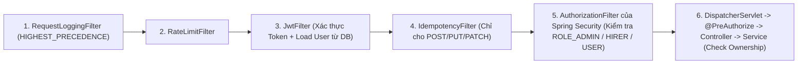

# Danh Sách Giải Pháp Kiến Trúc & Xử Lý Vướng Mắc Authenticate / Authorize Cho Hot-GET Filter

> Tài liệu này đánh giá trực tiếp đề xuất **"dùng `Filter` để trả về luôn thay vì đi vào Service"** trong bối cảnh thực tế của `job-backend`, phân tích sâu điểm vướng ở **`Authenticate` và `Authorize`**, và đề xuất **5 phương án kiến trúc** từ cơ bản đến tối ưu hiệu năng cao.

---

## 1. Đánh Giá Đề Xuất Dùng `Filter` Trả Về Thẳng Response

Đề xuất sử dụng `OncePerRequestFilter` là **rất phù hợp với kiến trúc hiện tại của `job-backend`** vì 3 lý do thực tế trong codebase:

1. **Đã có sẵn hạ tầng Filter chuẩn mực:** Dự án đang vận hành [RequestLoggingFilter.java](file:///d:/web-project/job-backend/src/main/java/com/nlu/shared/infrastructure/filter/RequestLoggingFilter.java), [RateLimitFilter.java](file:///d:/web-project/job-backend/src/main/java/com/nlu/identity/infrastructure/filter/RateLimitFilter.java), [JwtFilter.java](file:///d:/web-project/job-backend/src/main/java/com/nlu/identity/infrastructure/filter/JwtFilter.java) và [IdempotencyFilter.java](file:///d:/web-project/job-backend/src/main/java/com/nlu/shared/infrastructure/idempotency/IdempotencyFilter.java).
2. **Tái sử dụng `ContentCachingResponseWrapper` miễn phí:** `RequestLoggingFilter` (chạy ở `Ordered.HIGHEST_PRECEDENCE`) đã bọc sẵn `HttpServletResponse` trong `ContentCachingResponseWrapper` (trừ `/sse/`). Filter cache mới chỉ cần lấy `getContentAsByteArray()` khi ghi cache và khi Cache HIT chỉ việc viết thẳng byte ra response mà **không gọi `filterChain.doFilter(...)`**, bỏ qua hoàn toàn `DispatcherServlet`, Jackson serialization, Controller, Service và kết nối JDBC PostgreSQL.
3. **Cấu hình tập trung không đụng code nghiệp vụ:** Tương tự [IdempotencyProperties.java](file:///d:/web-project/job-backend/src/main/java/com/nlu/shared/infrastructure/idempotency/IdempotencyProperties.java), chỉ cần khai báo rule trong `application.yml` để bật/tắt cache cho từng GET endpoint.

---

## 2. Phân Tích Điểm Vướng: `Authenticate` & `Authorize` Trong Chuỗi Filter Hiện Tại

Hiện tại trong [SecurityConfig.java](file:///d:/web-project/job-backend/src/main/java/com/nlu/identity/infrastructure/config/SecurityConfig.java#L58-L87), thứ tự thực thi thực tế của một HTTP Request đi vào `job-backend` như sau:



Nếu đặt một `HotGetCacheFilter` một cách ngây thơ (ví dụ đặt trước `JwtFilter`, hoặc đặt cùng vị trí `IdempotencyFilter` trước `AuthorizationFilter`, hoặc cache key không phân biệt scope), hệ thống sẽ dính **4 lỗ hổng / nút thắt sau**:

| Vấn đề | Nguyên nhân kỹ thuật | Hậu quả |
| :--- | :--- | :--- |
| **1. Bypass Authentication** | Nếu đặt Filter *trước* `JwtFilter`, khi Client gọi `GET /api/user/applied` không gửi token (hoặc token hết hạn), Filter trả về cache luôn trước khi `JwtFilter` kịp từ chối. | **Lộ dữ liệu private** cho người chưa đăng nhập (`401` bị bỏ qua). |
| **2. Bypass Role Authorization (`403`)** | `IdempotencyFilter` hiện đặt `addFilterAfter(idempotencyFilter, JwtFilter.class)` — tức là nằm **trước `AuthorizationFilter`** của Spring Security! Nếu Cache Filter đặt ở đây cho endpoint `ROLE:ADMIN` dùng chung key, một `ROLE_USER` hợp lệ có thể lấy được cache của `/api/admin/dashboard/summary` trước khi Spring Security kịp kiểm tra `.hasAnyAuthority("ROLE_ADMIN", "ADMIN")`. | **Leo thang đặc quyền** (`403 Forbidden` bị vô hiệu hóa khi Cache HIT). |
| **3. Lộ dữ liệu chéo giữa 2 User cùng Role (IDOR qua Cache)** | Các endpoint như `GET /api/payments/{id}`, `GET /api/user/jobs/match/{cvId}`, `GET /api/hirer/applications/jobs/{jobId}/candidates/...` đều có cùng Role (`USER` hoặc `HIRER`), nhưng việc kiểm tra **"bản ghi này có thuộc về User đang gọi không"** (Ownership check) lại nằm tận trong tầng **Service**! Nếu User A xem `GET /api/payments/10` (thành công 5 lần) và Cache lưu key chỉ theo URL `/api/payments/10`, thì User B gọi `/api/payments/10` sẽ trúng cache của User A! | **Rò rỉ dữ liệu cá nhân (IDOR)** nghiêm trọng giữa các người dùng. |
| **4. Nút thắt ẩn tại `JwtFilter` (`dbLoadUser`)** | Tại [JwtFilter.java](file:///d:/web-project/job-backend/src/main/java/com/nlu/identity/infrastructure/filter/JwtFilter.java#L85), với mọi endpoint không nằm trong `PUBLIC_GET_ENDPOINTS`, `JwtFilter` đều gọi `userDetailsService.loadUserByUsername(userEmail)` — tức là **vẫn bắn 1 câu `SELECT` xuống PostgreSQL** ở mỗi request có token dù phía sau có dùng Cache Filter! | Mất đi một phần lợi ích giảm tải DB nếu không tối ưu `JwtFilter`. |

---

## 3. Danh Sách Các Giải Pháp Kiến Trúc

Dưới đây là **5 giải pháp** giải quyết trọn vẹn bài toán từ góc độ bảo mật, hiệu năng và độ phức tạp triển khai.

---

### Giải pháp 1 (Khuyên dùng làm nền tảng chính): Đặt `HotGetCacheFilter` SAU `AuthorizationFilter` + Khóa Cache Đa Phạm Vi (`PUBLIC` / `ROLE` / `USER:{id}`)

#### Nguyên lý hoạt động
1. **Vị trí Filter:** Trong [SecurityConfig.java](file:///d:/web-project/job-backend/src/main/java/com/nlu/identity/infrastructure/config/SecurityConfig.java), đăng ký Filter bằng:
   `.addFilterAfter(hotGetCacheFilter, AuthorizationFilter.class)`
   *(Lưu ý: dùng `AuthorizationFilter.class` của Spring Security 6, không dùng `FilterSecurityInterceptor` cũ).*
2. **Tại sao vị trí này giải quyết được cả Authenticate và URL Authorize?**
   - Request bắt buộc phải đi qua `JwtFilter` (xác thực JWT, kiểm tra user active/locked, điền `SecurityContextHolder`).
   - Sau đó request đi qua `AuthorizationFilter` của Spring Security để kiểm tra toàn bộ luật URL trong [ApiConstants.java](file:///d:/web-project/job-backend/src/main/java/com/nlu/identity/domain/vo/ApiConstants.java) (`PUBLIC_GET_ENDPOINTS`, `HIRER_ENDPOINTS`, `USER_ENDPOINTS`, `ADMIN_ENDPOINTS`, `AUTHENTICATED_ENDPOINTS`). Nếu người dùng chưa đăng nhập (`401`) hoặc sai Role (`403`), Spring Security **chặn ngay trước khi chạm tới `HotGetCacheFilter`**.
3. **Giải quyết Ownership Check trong Service bằng Phân Tách Scope của Cache Key:**
   Mỗi endpoint khai báo một thuộc tính `scope`:
   - `PUBLIC`: `http_cache:entry:{endpointId}:public:{lang}:{hash}` (dùng chung mọi người).
   - `ROLE`: `http_cache:entry:{endpointId}:role:{primaryRole}:{lang}:{hash}` (chỉ dùng cho nhóm Admin Dashboard/Metrics dùng chung giữa các Admin).
   - `USER`: `http_cache:entry:{endpointId}:user:{userId}:{lang}:{hash}` (bắt buộc gắn `user.getId()`).
     - Với API cần Ownership check (`GET /api/payments/{id}`, `/api/user/jobs/match/{cvId}`, `/api/hirer/applications/...`): User A gọi 5 lần hợp lệ mới vào được hộc `user:101`. User B gọi vào sẽ tìm ở hộc `user:202` $\rightarrow$ **Cache MISS** $\rightarrow$ đi xuống Controller/Service $\rightarrow$ Service kiểm tra Ownership và ném `403/404` $\rightarrow$ không bao giờ được cache và không bao giờ đọc trộm được của User A.

#### Ưu & Nhược điểm
- **Ưu điểm:** An toàn tuyệt đối với cả Authentication, Role-based Authorization lẫn Ownership-based Authorization mà vẫn giữ nguyên cơ chế "Filter trả về thẳng, không xuống Controller/Service".
- **Nhược điểm:**
  - Nếu một Controller dùng `@PreAuthorize` kiểm tra tham số động kiểu SpEL (`@PreAuthorize("#id == authentication.principal.id")`) mà chưa khai báo ở `SecurityConfig`, `@PreAuthorize` chạy ở tầng AOP sau Filter nên sẽ bị bypass. *(Rà soát thực tế trong `job-backend`: tất cả `@PreAuthorize` hiện tại chỉ kiểm tra Role tĩnh `hasAnyAuthority('ROLE_HIRER', ...)` / `ROLE_USER` / `ROLE_ADMIN`, vốn trùng khớp với `ApiConstants`, nên không bị vướng SpEL).*
  - Vẫn chịu 1 query `loadUserByUsername` ở `JwtFilter` đối với các endpoint có xác thực.

---

### Giải pháp 2 (Tối ưu hiệu năng tối đa): Kiến Trúc Filter 2 Tầng (Fast-Path Public + Auth Cache) & Cache `UserDetails` Trong `JwtFilter`

Đây là bản nâng cấp của Giải pháp 1 để giải quyết triệt để **nhược điểm thứ 4 (`dbLoadUser` trong `JwtFilter`)** và giúp các API Public bỏ qua cả chuỗi Filter bảo mật khi Cache HIT.

#### Nguyên lý hoạt động
1. **Luồng Fast-Path cho `PUBLIC_GET` (trước `JwtFilter`):**
   - Các API thuần Public ở Nhóm A (`GET /api/jobs/**`, `/api/blogs/**` trừ `/api/blogs/me`, `/api/v1/categories`, `/api/home/init`, `/api/addresses/address-count`, `/api/language`) không bao giờ cần `JwtFilter` hay `AuthorizationFilter` (thực tế `JwtFilter.shouldNotFilter` cũng đã bỏ qua chúng).
   - Cho phép nhánh `PUBLIC` kiểm tra cache ngay sau `RateLimitFilter`. Khi HIT, trả response ngay mà không đi qua `SecurityContextHolder` hay `AuthorizationFilter`.
2. **Luồng Protected GET (sau `AuthorizationFilter`) kết hợp Cache `UserDetails` trong `JwtFilter`:**
   - Tại [JwtFilter.java](file:///d:/web-project/job-backend/src/main/java/com/nlu/identity/infrastructure/filter/JwtFilter.java#L85), thay vì gọi thẳng DB ở mọi request, bọc `UserRepositoryDetailsService` bằng Redis cache (`auth:user:{email}`, TTL ngắn `3–5 phút`, tự xóa ngay khi user đổi mật khẩu, bị khóa tài khoản, hoặc admin sửa user).
   - Khi đó, một request `GET /api/hirer/jobs/posted` hoặc `GET /api/admin/dashboard/summary` khi Cache HIT sẽ đạt **0 query PostgreSQL hoàn toàn** từ đầu đến cuối!

#### Ưu & Nhược điểm
- **Ưu điểm:** Đạt hiệu năng tối đa (0 DB hit cho cả Public lẫn Authenticated GET), xử lý được nút thắt `dbLoadUser` đã lộ rõ trong log `[PERF][Filter:Jwt]` của dự án.
- **Nhược điểm:** Phải cẩn thận invalidation cache `auth:user:{email}` khi khóa/mở khóa tài khoản hoặc đổi quyền để tránh token cũ còn hiệu lực trong vài phút TTL.

---

### Giải pháp 3: Khai Báo Tập Trung Qua `application.yml` (`HotCacheProperties`) & Tự Động Xóa Cache Trên Cùng Filter

Để tránh việc phải rải `redisTemplate.delete(...)` vào hàng chục Service khác nhau, ta mở rộng mô hình cấu hình của [IdempotencyProperties.java](file:///d:/web-project/job-backend/src/main/java/com/nlu/shared/infrastructure/idempotency/IdempotencyProperties.java) cho cả chiều **Đọc (Cache)** và chiều **Ghi (Auto-Invalidation)**.

#### Minh họa cấu trúc cấu hình đề xuất
```yaml
app:
  hot-cache:
    enabled: true
    default-threshold: 5
    default-window-seconds: 60
    max-body-bytes: 65536
    gzip-threshold-bytes: 2048
    rules:
      - id: public_job_detail
        pattern: "GET /api/jobs/{id}"
        scope: PUBLIC
        threshold: 5
        window-seconds: 300
        ttl-seconds: 600
        max-entries: 500
        invalidate-on:
          - "PUT /api/hirer/jobs/{id}"
          - "DELETE /api/hirer/jobs/{id}"
          - "PATCH /api/admin/jobs/{id}/status"
      - id: user_job_match
        pattern: "GET /api/user/jobs/match/{cvId}"
        scope: USER
        threshold: 3
        window-seconds: 120
        ttl-seconds: 600
        max-entries: 300
        invalidate-on:
          - "DELETE /api/user/resumes/{cvId}"
          - "POST /api/user/resumes/{cvId}/analyze"
```

#### Nguyên lý Auto-Invalidation trên Filter
- Khi một request ghi (`POST`, `PUT`, `PATCH`, `DELETE`) đi qua Filter và trả về HTTP `2xx`:
  - Filter đối chiếu URI của request ghi với danh sách `invalidate-on` của các rule.
  - Có thể trích biến đường dẫn (`{id}`, `{cvId}`) bằng `AntPathMatcher.extractUriTemplateVariables(...)` để xóa **đúng key cụ thể** (ví dụ sửa job `42` chỉ xóa cache `GET /api/jobs/42`), hoặc xóa toàn bộ `ZSET` của danh sách liên quan (như `GET /api/jobs/newest`).

#### Ưu & Nhược điểm
- **Ưu điểm:** Quản lý toàn bộ chính sách cache & invalidation ở 1 file cấu hình duy nhất; dễ bật/tắt từng endpoint khi có sự cố; không làm bẩn code domain/service.
- **Nhược điểm:** Chỉ bắt được các thay đổi phát sinh qua HTTP API; các tác vụ cập nhật nền từ **RabbitMQ Consumer** (`ResumeParsingConsumer`, `JobVectorizationConsumer`) hoặc `@Scheduled` job vẫn cần gọi trực tiếp `hotCacheService.evict(...)`.

---

### Giải pháp 4: Đặt Ở Tầng `HandlerInterceptor` (Spring MVC) Hoặc Spring AOP (`@HotCacheable`)

Thay vì dùng Servlet Filter, logic đếm và trả cache đặt sau bước mapping của `DispatcherServlet` (bên trong `HandlerInterceptor.preHandle` hoặc Spring AOP `@Around`).

#### Nguyên lý hoạt động
- `HandlerInterceptor` chạy **sau toàn bộ Security FilterChain** và có sẵn `HandlerMethod` (biết chính xác Controller method nào sắp chạy, annotation `@HotCacheable` gắn trên method nào).
- Nếu dùng AOP (`@HotCacheable`), cache lại đối tượng Java DTO thay vì `byte[]` HTTP response, và chạy **sau** `@PreAuthorize` ở tầng method.

#### Ưu & Nhược điểm
- **Ưu điểm:**
  - Nếu sau này dự án có thêm `@PreAuthorize` phức tạp kiểm tra điều kiện trên tham số method (SpEL), AOP chạy sau `@PreAuthorize` nên chắc chắn không bị bypass.
  - Ở `HandlerInterceptor`, có sẵn `HandlerMapping.URI_TEMPLATE_VARIABLES_ATTRIBUTE` giúp lấy `{id}` rất dễ dàng.
- **Nhược điểm:**
  - Không "ngắt mạch" sớm bằng Filter: Request vẫn phải đi qua toàn bộ `DispatcherServlet`, tìm `HandlerMapping`, bind tham số/converter (và với AOP thì vẫn tốn chi phí `ApiResponse` + Jackson serialize lại ở mỗi lần gọi!).
  - Phải cấu hình rải rác trên từng Controller/Service thay vì tập trung như Filter.

---

### Giải pháp 5: Bổ Sung Chống `Cache Stampede` (Single-Flight) & Tối Ưu Truyền Tải (`Gzip` + `ETag`)

Đây là giải pháp nâng cao đi kèm với Giải pháp 1 hoặc 2 để chống sập DB khi có lưu lượng đột biến:

1. **Chống Cache Stampede (`Thundering Herd`) khi Hot Key vừa hết hạn TTL:**
   - Giả sử tin tuyển dụng `/api/jobs/100` đang cực hot (500 người mở cùng lúc). Đúng giây thứ 600, TTL hết hạn $\rightarrow$ 500 request đồng loạt thấy Cache MISS và cùng đâm xuống PostgreSQL.
   - **Cách xử lý (tận dụng đúng kỹ thuật `SET NX EX` ở `IdempotencyService.tryAcquire`):**
     - Chỉ **1 request đầu tiên** giành được khóa `http_cache:lock:{entryKey}` (`TTL 5s`) được phép đi xuống DB truy vấn và nạp lại cache.
     - Các request song song chờ ngắn (`50–100ms` và đọc lại cache) hoặc dùng kỹ thuật **Stale-While-Revalidate** (giữ cache cũ thêm `30s` phục vụ tạm cho 499 người còn lại trong khi 1 người âm thầm làm mới).
2. **Nén Gzip trong Redis & Hỗ trợ `304 Not Modified`:**
   - Tự động nén Gzip khi response `> 2 KB` trước khi ghi vào Redis để giảm ~70% RAM và băng thông mạng tới Redis.
   - Gắn thêm header `X-Cache: HIT / MISS / COUNTING` (tương tự `X-Idempotent-Replayed` trong [SecurityConfig.java](file:///d:/web-project/job-backend/src/main/java/com/nlu/identity/infrastructure/config/SecurityConfig.java#L105) cần expose trong CORS) để dễ đo lường hiệu quả qua log `[PERF]`.

---

## 4. Bảng So Sánh & Đề Xuất Lộ Trình Áp Dụng Cho `job-backend`

| Tiêu chí | Giải pháp 1 (`Filter` sau `AuthorizationFilter`) | Giải pháp 2 (2-Tầng + Cache `JwtFilter`) | Giải pháp 3 (`YAML` + Auto-Invalidation) | Giải pháp 4 (`Interceptor` / AOP) |
| :--- | :---: | :---: | :---: | :---: |
| **An toàn AuthN & Role AuthZ** | Rất cao (chặn bởi `AuthorizationFilter`) | Rất cao (Public tách riêng, Protected qua `AuthorizationFilter`) | Phụ thuộc vị trí đặt Filter | Tuyệt đối (chạy sau cả `@PreAuthorize`) |
| **An toàn Ownership (IDOR)** | Cao (nhờ `scope: USER` gắn `userId`) | Cao (nhờ `scope: USER` gắn `userId`) | Cao | Cao |
| **Tốc độ khi Cache HIT** | Rất nhanh (bỏ qua MVC & DB nghiệp vụ) | **Nhanh nhất (0 query DB ở cả `JwtFilter`)** | Như GP 1/2 | Chậm hơn Filter (qua `DispatcherServlet` / Jackson) |
| **Quản lý tập trung** | Tốt | Tốt | **Tốt nhất** | Trung bình (rải trên code) |
| **Độ phức tạp triển khai** | Thấp – Trung bình | Trung bình – Cao | Trung bình | Trung bình |

### Lộ trình triển khai khuyên dùng (3 bước gọn gàng)
1. **Giai đoạn 1 (Triển khai cốt lõi — GP 1 + GP 3):**
   - Xây dựng `HotGetCacheFilter` đặt **sau `AuthorizationFilter.class`**, sử dụng `byte[]` + Gzip (tránh `GenericJackson2JsonRedisSerializer` double-escape), giới hạn `maxEntries` bằng `Redis ZSET`, và áp dụng trước cho **11 API Nhóm A (`PUBLIC`)** + cấu hình `invalidate-on` trong `application.yml` (đồng thời gộp/thay thế `CategoryCacheService` hiện tại cho `/api/home/init` và `/api/addresses/address-count`).
2. **Giai đoạn 2 (Mở rộng sang Protected API & tối ưu `JwtFilter` — GP 2):**
   - Thêm lớp cache `UserDetails` trong `JwtFilter` (với cơ chế xóa cache khi cập nhật/khóa user), sau đó bật rule cho **Nhóm B (`ROLE:ADMIN`)** và các API nặng của **Nhóm C (`USER:{id}`)** như `/api/user/jobs/match/{cvId}`, `/api/hirer/jobs/posted`.
   - Bổ sung gọi `evict` trong các RabbitMQ Consumer (`ResumeParsingConsumer`, `JobVectorizationConsumer`).
3. **Giai đoạn 3 (Chống tải đột biến — GP 5):**
   - Bổ sung `Single-Flight Lock` (`SET NX EX`) cho các key có traffic cao để chống Cache Stampede và gắn `X-Cache` vào `exposedHeaders` của CORS trong [SecurityConfig.java](file:///d:/web-project/job-backend/src/main/java/com/nlu/identity/infrastructure/config/SecurityConfig.java#L104-L105) để theo dõi tỷ lệ Cache Hit thực tế.

